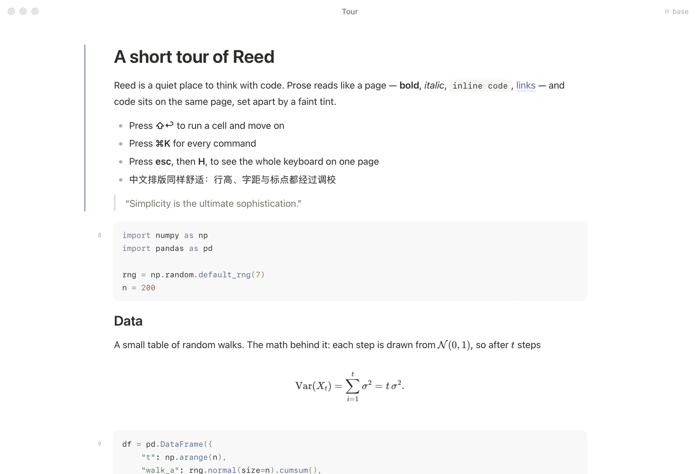
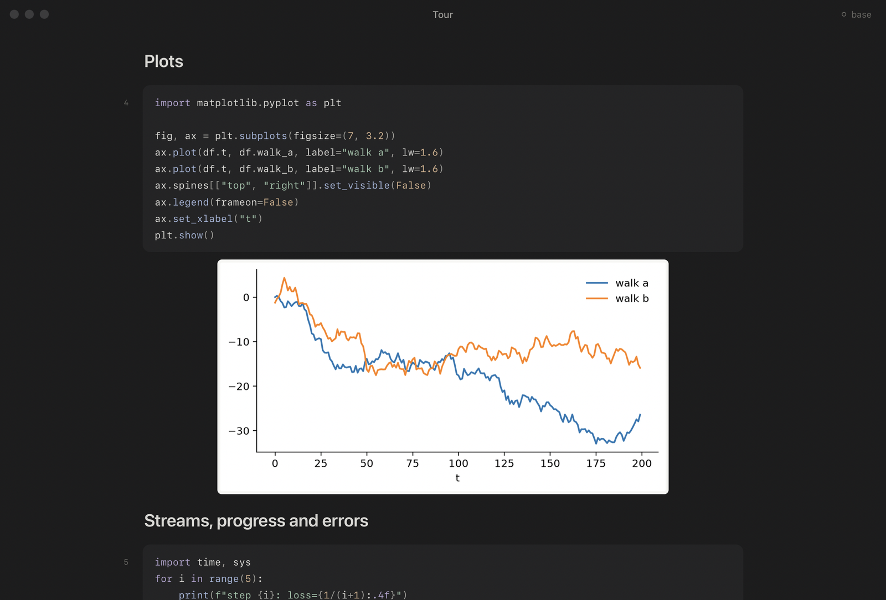

<p align="center"></p>

<p align="center"><b>English</b> · <a href="README.zh-CN.md">简体中文</a> · <a href="https://j1c21.github.io/reed/">Website</a></p>

# Reed

A quiet Jupyter notebook editor, made for macOS and nothing else.

It gives your attention back to the content, as Typora does, and can run reactively, as marimo does;
what it reads and writes is still plain `.ipynb`, and what it talks to is still the Jupyter kernels already on your machine.

A reed is enough. The *Book of Songs* asks, "Who says the river is wide? A single reed will cross it."
A reed cut to a point was the first pen, and Pascal called man a thinking reed. The icon is that one reed.





- **Light.** The whole app is about 4 MB: a native Swift shell around the WebKit that ships with macOS. No Electron, no bundled Python.
- **Fast.** The window is up in about 0.2 s; a kernel starts only when you first run something or begin typing code.
- **Faithful.** Open a notebook and save it unchanged, and the file is the same, byte for byte.

## Features

**One page**

- Cells have no frames. Code is set apart only by a very faint tint, output lands directly on the page, and figures and tables
  sit in the middle of the column, like a typeset document.
- Which cell you are in is told by one thin line in the left margin: ink blue while the cell is selected, grey while you type in it;
  select several cells and it becomes one longer line.
- That line *travels*. Moving the selection, adding, removing or moving cells, paging, jumping to a search match, Markdown switching
  between source and rendering, folding or clearing output — all of it glides into place on the same curve and in the same 0.2 s,
  with no bounce. A cell that is run again keeps its height while it runs, so the page does not collapse and open up again.
  With "Reduce motion" on in macOS, none of it moves.
- **Autosave** is on by default: 1.2 s after you stop typing, when the window loses focus, and every 20 s during a long run.
  Closing a window asks nothing. If another program has changed the file, autosave stops and says so rather than overwrite it
  (`⌘S` still forces a save). It can be turned off in Settings (`⌘,`).

**Keyboard first**

- At rest the page has no buttons. The pointer does very little — click on text to put the caret there, click on the blank beside it
  to select that cell, scroll, right-click for a menu — and two things appear only when it comes to rest where they belong:
  - **Copy.** With the pointer on a cell's text, or on one piece of its output, a copy button appears in the right margin, level with
    the first line; click it and it turns into a tick. It copies that cell (as `C` does) or that piece of output: a figure as the
    picture, a table as both tab-separated text and HTML, a formula as its TeX, Markdown output as it was written, JSON as JSON,
    anything else as the text you read on the page. Copying moves neither the caret nor the selection, so you can be typing in
    one cell and fetch something from another. In a cell taller than the window, the button stays at the top of the window.
  - **Add.** Rest the pointer in the gap between two cells (or before the first, or after the last) and a small mark appears in the
    middle of the gap: a short rule, `TEXT`, a dot, `CODE`, a short rule. The mark is small, centred, with paper all round it —
    a mark on the page, not a border drawn on the cells. What you can click is not small: once the mark is showing, the whole gap
    left of the middle is `TEXT` (adds a text / Markdown cell) and the whole gap right of it is `CODE` (adds a code cell). Click
    wherever you are and the caret lands in the new cell; there is nothing to aim at. The gap counts a few pixels extra above and
    below, and the blank after the last cell counts for more. A double click (easily done on a trackpad) adds one cell, not two.

  Neither gets in the way: a pointer passing over does not make them flash (they take a moment to appear and cannot be clicked
  before they have — that click is still a click on the page); any key puts them away until the pointer moves again; they stay away
  while you drag across text, and in a window that is in the background. Everything else is done from the keyboard.
- **The command palette, `⌘K`**, is the way in to everything: every command, searched by name, the ones you used last at the top
  (`⌘K` `↩` repeats the last one). It is also the only panel — there is no sidebar. The same panel does the other
  "pick one by name" jobs: **choose a kernel `⌥⌘K`**, **go to a heading `⌘J`**, **open a notebook `⇧⌘O`** (recent ones, plus those in
  the current folder), **the kernel's variables `⌥⌘V`** (name, type, value; `↩` writes the name at the caret).
  `⌫` in an empty field goes back to the list of commands.
- Going between the two states takes only the arrow keys: at the start of a line, press `←` twice to step out of the text and select
  the cell (the same as `esc`); with a cell selected, press `→` twice to go back into the text, caret where it was. A held `←`, or one
  that merely arrives at the start of the line, only moves the caret — no accidents.
- Menus and the controls inside output can be worked from the keyboard: with a cell selected, `Tab` goes into its output
  (ipywidgets sliders, drop-downs and checkboxes, task-list checkboxes, links).
- Whatever borrows the keyboard gives it back: open the palette or Find while typing in a cell, close it, and the caret is where it was.
- **Settings, `⌘,`**, is one more list in the same palette: appearance, serif type, a wider page, line numbers, wrapping, focus and
  typewriter modes, the completion list, autosave, reactive execution — each showing its current state; `↩` toggles it, and you can
  change several in a row. These switches are no longer scattered through the menu bar.
- `H` (or `F1`) shows every key on one page, at any time.

**Writing**

- A Markdown cell has no frame; it reads like body text on paper. The left of a cell of prose — as far across as its text goes, and
  at least three fifths of the column — is *text*: the pointer is an I-beam, a click edits in place, and the caret lands where you
  clicked (at the end of the line if you clicked in the blank to its right, in the nearer paragraph if you clicked between two).
  What is left on the right is the cell itself: the pointer is an arrow, and a click selects the cell. Crossing a cell, the pointer
  changes shape once; it does not flicker between one word and the next. While you edit, headings and bold keep their rendered size
  and weight, and the cell is rendered again the moment you leave it.
- The margins either side of the cells, the gaps between them and the blank after the last one all count as paper: a click selects
  the cell level with it (`⇧`-click extends the selection) and never drops the caret into some line.
- LaTeX math (KaTeX), tables, task lists (tick them where they stand), highlighted code blocks, local images and attachments.
- `↑` on a cell's first line and `↓` on its last walk straight into the next cell, so the notebook reads as one document.
- Deleting text never deletes a cell: hold `⌫` and it stops when the cell is empty; to remove the empty cell, press `⌫` twice,
  quickly (the first press leaves a faint hint in the cell).
- `⇧⌘M` / `⇧⌘Y` turn the current cell into text / code without leaving it; the caret stays where it is.
- Immersion: while you type, the title, the kernel status, the run counts and the rest fade out, and they come back when the
  pointer moves. **Focus mode** (`F8`) keeps only the current cell at full strength; **typewriter mode** (`F9`) holds the line you
  are typing at a fixed height in the window.

**Code**

- A CodeMirror 6 editor; `⇧Tab` for documentation.
- **Completion is quiet.** Nothing pops up as you type; the rest of the likeliest name is shown, faintly, after the caret.
  `Tab` takes it (so does `→` at the end of a line), typing on ignores it, and `↩` is only ever a new line. Suggestions come from
  the kernel; names already used in the notebook come first. For the full list press `⌥esc`, or `Tab` where no name has been
  started yet, as after `np.`. If you prefer a list that follows your typing, turn on *Completion List While Typing* in Settings (`⌘,`).
- Output: streamed text (ANSI colours, `\r` progress bars), tracebacks, DataFrame tables, images (at Retina sharpness by default),
  SVG, LaTeX, a JSON tree, Markdown, and output that needs scripts, such as Plotly and Altair.
- ipywidgets are drawn natively: `tqdm` progress bars, the sliders / drop-downs / checkboxes of `interact`, buttons, Tab, Accordion, Output.
- `input()` is answered in place; `display(..., display_id=True)` updates in place; `clear_output(wait=True)` works.
- Output can be taken away as it is: put the pointer on a piece of output and click the copy button that appears to its right; or
  select the cell and press `⇧C` to copy its output (the figure if there is one, the table if there is one, otherwise the text);
  or right-click a figure, a table or text for "Copy Image / Save Image… / Copy Table / Copy Output".
  A copied table carries both tab-separated text and HTML, so it pastes as a table into Numbers, Excel or Notes.
- A figure can be looked at up close: double-click it, or `Tab` to it and press `↩`; while it is enlarged `⌘C` copies it, and any key
  or a click puts it back.

**Reactive execution**

- After a cell runs, the numbers of the cells that depend on it turn amber: their results are out of date (so are those of a cell
  whose code was edited and not run again). `Run ▸ Run Stale Cells` brings them all up to date.
- Turn on `Run ▸ Reactive Execution` and dependent cells rerun by themselves, in dependency order, as in marimo; while it is on
  there is a ⚡ in the title bar, and clicking it turns it off.
- Dependencies are worked out by Python itself, in the kernel, with `symtable` / `ast`, so scoping is never guessed wrong.
  Unlike marimo, the same name may be assigned in several cells — a reference resolves to the nearest definition above it in the document.

**Kernels**

- Registered kernelspecs are found automatically, and so are Python environments that have `ipykernel`: conda environments,
  a `.venv` beside the project, pyenv, uv and others.
- Environments without `ipykernel` are listed too; choose one in the kernel list and press `↩` to install it.
- Interrupt (`⌘.`), restart, restart and run all; kernels end when the app quits.

**Mac**

- A native menu bar, native Save and Open panels, Open Recent, `.ipynb` files dropped on the app or double-clicked in the Finder,
  several windows, full screen.
- The title bar holds the file name and the kernel, nothing else. **The file name is text you can change where it stands**: click it
  and the caret is at the letter you clicked, with no box drawn round it and nothing shifting; a double click selects a word,
  `⌘A` selects all, `↩` confirms, `esc` cancels, and clicking elsewhere confirms too; press and drag still moves the window.
  Reached from the palette (Rename…) or `File ▸ Rename…`, the whole name is selected, ready to be typed over.
  If a file of that name exists you are told and can go on editing; for a notebook that has never been saved, clicking the name is Save As.
- Every command in the menu bar shows its shortcut. Unsaved changes are shown the way macOS shows them (the dot in the close button).
- Light, dark, or following the system; body text can be set in a serif face and the page made wider (both in Settings).
- Find in the whole notebook, `⌘F`: `↩` / `⇧↩` step through the matches, `⌘G` / `⇧⌘G` find the next / previous one from anywhere
  (starting at the caret), and after `esc` you are left at the match.

## Shortcuts

**Anywhere**

| | |
|---|---|
| Command palette / go to heading / open notebook / choose kernel / variables / settings | `⌘K` / `⌘J` / `⇧⌘O` / `⌥⌘K` / `⌥⌘V` / `⌘,` |
| Find / next / previous | `⌘F` / `⌘G` / `⇧⌘G` |
| Run all / interrupt the kernel | `⇧⌘↩` / `⌘.` |
| Move the cell up / down | `⌃⇧↑` / `⌃⇧↓` |
| Make it text / code | `⇧⌘M` / `⇧⌘Y` |
| Split at the caret | `⌃⇧-` |
| Focus mode / typewriter mode | `F8` / `F9` |
| All the keys on one page | `F1` |

**While typing in a cell**

| | |
|---|---|
| Run and go on / run / run and add a cell below | `⇧↩` / `⌘↩` (or `⌃↩`) / `⌥↩` |
| Leave the cell (keys then act as commands) | `esc`, or `←` twice at the start of a line |
| Walk into the next cell | `↑` on the first line, `↓` on the last |
| Remove an empty cell | `⌫` twice |
| Take the faint suggestion / show them all | `Tab` (`→` at the end of a line) / `⌥esc` |
| Documentation / comment out | `⇧Tab` / `⌘/` |

**With a cell selected** (after `esc`; the same as Jupyter's command mode)

| | |
|---|---|
| Edit it | `↩`, or `→` twice |
| Previous / next cell, extend the selection | `K` / `J` (or `↑` `↓`), with `⇧` to extend |
| Page down / up (the selection goes along) | `space` / `⇧space` |
| New cell above / below | `A` / `B` |
| Make it text / code / raw | `M` / `Y` / `R` |
| Cut / copy / paste, delete, undo | `X` / `C` / `V`, `D D`, `Z` |
| Copy the output (figure / table / text) | `⇧C` |
| Merge with the cell below | `⇧M` |
| Fold the output / the code, line numbers | `O` / `⇧O`, `L` |
| Into the controls in the output | `Tab` (`esc` to come back) |
| Interrupt / restart the kernel | `I I` / `0 0` |
| Go to heading / command palette / all the keys | `G` / `P` / `H` |

**In a list** (the palette, a menu): `↑` `↓` to move, `↩` to choose, `esc` to go back to the notebook.

Holding a key down repeats only the keys that move; holding `B` will not insert a row of cells, and holding `D` will not empty the notebook.

## Install

Download `Reed-0.1.0-macos-arm64.zip` from [Releases](https://github.com/J1c21/reed/releases), unzip it, and drag Reed into Applications.

- It needs a Mac with Apple silicon. This version has been built and used on macOS 27 only; earlier systems
  (the declared minimum is macOS 13) have not been tried.
- Reed is not notarised by Apple (that takes a paid developer account), so macOS stops it the first time: go to
  System Settings → Privacy & Security and click "Open Anyway" near the bottom; or run
  `xattr -dr com.apple.quarantine /Applications/Reed.app` in Terminal.
- Code runs in the Python environments you already have. Environments without `ipykernel` are listed too; choose one in the
  kernel list (`⌥⌘K`) and press `↩` to install it.

If you would rather not run a downloaded app, build it from source as below; it takes about half a minute.

## Build

You need macOS 13 or later, the Xcode Command Line Tools (Swift 5.9+), and Node 20+.

```bash
scripts/build-app.sh          # produces build/Reed.app
```

Put it in Applications and open it from there:

```bash
ditto build/Reed.app /Applications/Reed.app && open /Applications/Reed.app
```

(If Reed is already installed and running, quit it first, or copy the new one in under another name and swap the two, so as not to
overwrite an app that is running.)

To try a fresh build without installing it, use `scripts/staged.sh` (it takes a notebook path). Do not `open build/Reed.app` —
see "Checks" below for why.

## Architecture

```
Sources/
  ReedCore/            the core, independent of any interface (Foundation + Network + CryptoKit)
    ZMTP.swift           a pure-Swift client for ZeroMQ's wire protocol (ZMTP 3.0) — no libzmq
    JupyterWire.swift    Jupyter message framing and HMAC signing
    KernelSpec.swift     discovery of kernelspecs and Python environments
    KernelSession.swift  one kernel: a child process and its shell / iopub / stdin / control channels
    KernelManager.swift  kernel lifecycle, and its RPC
    RPC.swift            transport-agnostic RPC routing
    FileService.swift    reading and writing files, preferences
  Reed/                the AppKit shell: windows, menus, WKWebView, the reed:// resource scheme
  reed-dev/            a headless host for development: the same RPC over a local WebSocket

web/                   the interface (SolidJS + CodeMirror 6 + TypeScript, built with Vite)
  src/host/              talking to the host: script messages in the app, a WebSocket in development
  src/kernel/            Jupyter protocol client, kernel control, dependency analysis, ipywidgets models
  src/notebook/          the document model, reading and writing ipynb, the run queue, commands and keys
  src/editor/            CodeMirror setup, completion, find
  src/render/            Markdown, ANSI, output renderers (registered by MIME type)
  src/ui/                components
  src/styles/            design tokens and styles
```

A few decisions worth mentioning:

- **The native layer does not parse kernel messages.** Swift handles ZeroMQ frames and signatures and passes the JSON through
  untouched; messages that arrive within one turn of the event loop go to the page as one batch, so even a flood of output does not stall it.
- **What is in a notebook is not trusted.** The page has a strict CSP; Markdown and static HTML are sanitised, and HTML output lives
  in a shadow root (so styles leak neither way); output that needs scripts runs in a sandboxed iframe with an opaque origin, where
  it cannot reach the page, the native bridge or the file system. The native bridge answers only the app's own top-level page.
- **Progressive mounting.** A large notebook renders its first screenful at once; the remaining cells are filled in when the page
  is idle, or immediately when you scroll near them.

## Development

```bash
swift run reed-dev            # terminal one: the host (ws://127.0.0.1:47821)
npm --prefix web run dev      # terminal two: the interface (http://localhost:5199/?file=/absolute/path.ipynb)
```

The real app can also load the development server, with hot reloading:

```bash
REED_DEV_URL=http://localhost:5199 swift run Reed examples/tour.ipynb
```

**Checks**

```bash
swift run reed-dev --selftest                 # a real kernel, end to end: execute, interrupt, stdin, shut down
npm --prefix web run typecheck
```

The app has a snapshot mode that leaves the desktop alone, for driving the real app from a script. The window sits off screen and
never takes the keyboard, but the page believes it is in front: hover, focus rings and selection colours are what they are in real
use (WebKit withholds them from a page in a background window).

```bash
scripts/staged.sh examples/tour.ipynb \
  --size 1100x800 \
  --menu "Run/Run All" \
  --eval "await new Promise(r => setTimeout(r, 6000)); return document.title" \
  --snapshot /tmp/reed.png
```

`scripts/staged.sh` runs a twin of `build/Reed.app` (`build/ReedStage.app`: the same executable and interface under another
identifier and name, claiming no document types). Do not launch `build/Reed.app` itself: macOS remembers the copy that was launched
last, and from then on Spotlight, `open -a Reed` and a double-clicked `.ipynb` all open the one in the build folder — which the next
build deletes and makes again.

A `dispatchEvent` from a script reaches only the page's own handlers; what the browser engine itself does with a click (placing the
caret, moving focus) takes a real mouse event. In snapshot mode the native layer can send one:

```js
await window.webkit.messageHandlers.reed.postMessage({ method: 'test.mouse', params: { type: 'click', x: 640, y: 300 } })
```

`type` can also be `down` / `up` / `move` (the pointer moving with nothing pressed; hover depends on it) / `drag`;
`shift: true` holds ⇧ and `count: 2` makes it a double click. Available only in a `--snapshot` run.

To check what a copy actually put on the clipboard, give the run a pasteboard of its own (it leaves the system clipboard alone)
and read it back:

```bash
REED_PASTEBOARD=reed-test scripts/staged.sh … --snapshot /tmp/reed.png
```

```js
await window.webkit.messageHandlers.reed.postMessage({ method: 'test.pasteboard', params: {} })  // { text, html, png: byte count }
```

`examples/` holds three notebooks: `tour.ipynb` (a tour), `gallery.ipynb` (every kind of output), `reactive.ipynb` (reactive execution).

## License

[MIT](LICENSE).
